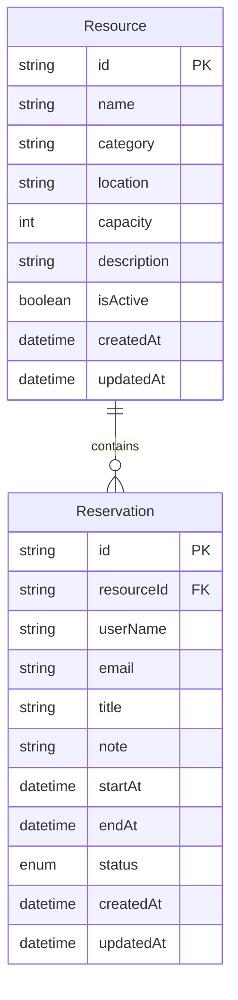

# ER Diagram

This diagram shows the core relationship between resources and reservations. One resource can have many reservations, while each reservation belongs to exactly one resource. The booking window (`startAt` and `endAt`) is protected by database checks: the end must follow the start, and active reservations for the same resource cannot overlap. Time ranges are half-open (`[start, end)`), so one reservation may begin exactly when another ends. Cancelled reservations do not block a slot.

The repository also includes [DBML source](./resource-reservation.dbml) for importing the model into dbdiagram.io.
