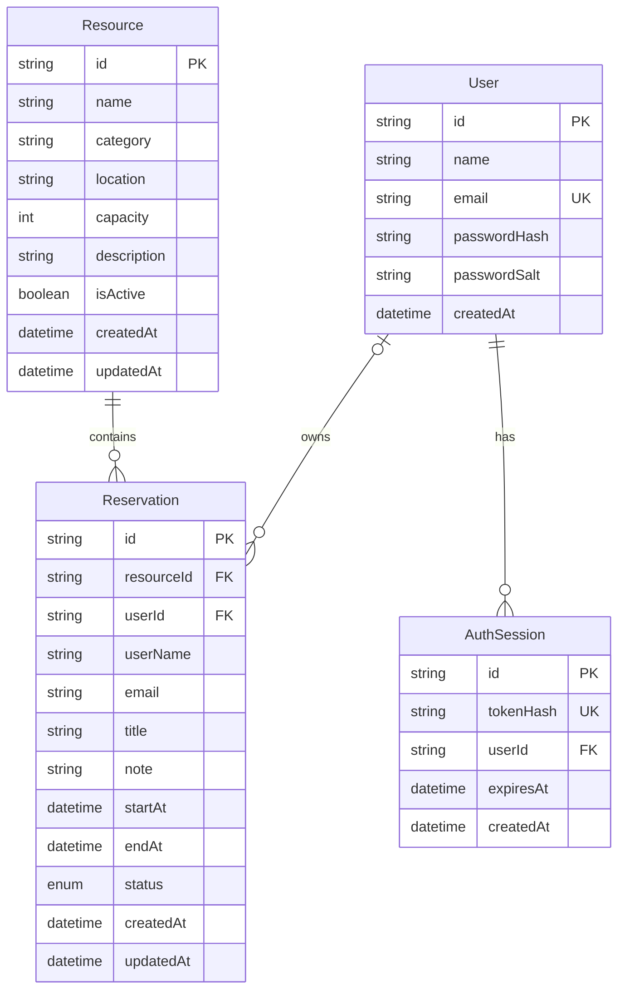

# ER Diagram

Each reservation belongs to one resource. A resource may have many reservations. A reservation may be linked to one user; `userId` is nullable to support reservations created before account-based booking was introduced. A user may own many reservations and have many authentication sessions.

The PostgreSQL migrations enforce `startAt < endAt` and prevent overlapping non-cancelled reservations for the same resource. Reservation time ranges are half-open (`[start, end)`), so a booking may begin exactly when another ends. Cancelled reservations do not block a time slot.

Deleting a resource cascades to its reservations. Deleting a user deletes their sessions and sets their reservations' `userId` to null.

See the [DBML source](./resource-reservation.dbml) for importing the model into dbdiagram.io.
